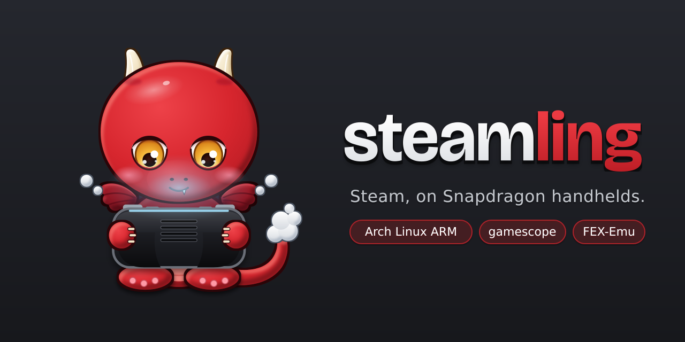

  

  <b>A handheld gaming operating system for Qualcomm Snapdragon devices.</b> 
  Steam's gaming mode, Windows games through Proton, and a full Linux desktop, built for ARM.

  
  
  

  <a href="https://sourceforge.net/projects/steamling/files/latest/download"><b>Download</b></a> ·
  <a href="https://github.com/Steamling/steamling/blob/main/docs/install.md"><b>Installation</b></a> ·
  <a href="https://github.com/Steamling/steamling/blob/main/docs/README.md"><b>Documentation</b></a> ·
  <a href="https://github.com/Steamling/steamling/releases"><b>Release notes</b></a> ·
  <a href="https://github.com/Steamling/steamling/issues"><b>Report a problem</b></a>

---

Steamling OS is a free, open-source operating system for handheld gaming devices built on
Qualcomm Snapdragon chips. It starts straight into Steam's gaming mode, runs Windows games through
Proton and the FEX x86 emulator, and keeps a complete Arch Linux ARM system underneath for desktop
use. Steamling is in early development: the Retroid Pocket 6 is its reference device, and support
for other handhelds is being brought up.

## Features

| | |
| --- | --- |
| **Game mode** | Steam's controller-first interface running on gamescope, the same session a Steam Deck uses |
| **Windows games on ARM** | Proton and FEX together, set up for each game automatically |
| **Tuned for each chip** | Steamling's own kernel, the Turnip Vulkan driver, a gaming CPU scheduler and fan control, configured per device family |
| **Governor** | A Quick Access Menu panel for per-game settings, performance, controls, display calibration and system management |
| **Updates over the air** | Signed system updates from Steamling's package repository, installed from game mode, with a snapshot taken before every one |
| **A stable base** | A tested snapshot of Arch Linux ARM that only moves forward with a Steamling release |
| **More than Steam** | Epic, GOG and Amazon games through Heroic, emulation through ES-DE, Android apps through Waydroid, and a KDE desktop |

## Supported devices

| Platform | Devices | Status |
| --- | --- | --- |
| Snapdragon 8 Gen 2 (SM8550) | Retroid Pocket 6 | **Reference device** |
| Snapdragon 8 Gen 2 (SM8550) | Retroid Pocket Nova, AYN Odin 2, Odin 2 Mini, Odin 2 Portal, AYN Thor, AYANEO Pocket ACE, DMG, DS, EVO and S | Untested port |
| Snapdragon 865 (SM8250) | Retroid Pocket 5, Flip 2, Mini and Mini V2, AYN Thor Lite, MANGMI Air Y Pro and Pocket Max, AYANEO Pocket MICRO 2 | Untested port |
| Snapdragon 8 Gen 3 (SM8650) | AYANEO Pocket S2, KONKR Pocket FIT | Untested port |
| Snapdragon 8 Elite (SM8750) | AYN Odin 3, KONKR Pocket FIT Elite | Untested port |

Release images are published for the Snapdragon 8 Gen 2 family; the other families can be
[built from source](https://github.com/Steamling/steamling/blob/main/docs/building/README.md).
An untested port has full device support in place but hasn't yet been confirmed on hardware.
[Supported devices](https://github.com/Steamling/steamling/blob/main/docs/devices.md) has the
details, and how to help test one.

## Releases and updates

Each release is published as an SD card image, with release notes on
[GitHub](https://github.com/Steamling/steamling/releases). Installing Steamling replaces the
handheld's bootloader with [OpenABL](https://github.com/OpenHandheldCollective/OpenABL), so read
the [installation guide](https://github.com/Steamling/steamling/blob/main/docs/install.md) first.

Once installed, Steamling keeps itself current: updates arrive from the package repository and
install from **Governor → System**, so a new release never needs a reflash. If an update causes
a problem, it can be rolled back with one button.

## Under the hood

| Layer | Component |
| --- | --- |
| Session | Steam for ARM on [gamescope](https://github.com/ValveSoftware/gamescope) |
| Compatibility | [Proton](https://github.com/ValveSoftware/Proton) and [FEX-Emu](https://github.com/FEX-Emu/FEX) |
| Graphics | [Mesa](https://www.mesa3d.org/): Turnip (Vulkan) and freedreno (OpenGL) |
| Kernel | Linux, with Steamling's handheld patches built on [ROCKNIX](https://github.com/ROCKNIX/distribution) and [armada](https://github.com/armada-os/armada) |
| Desktop | [KDE Plasma Mobile](https://plasma-mobile.org/) |
| Base system | [Arch Linux ARM](https://archlinuxarm.org/), as a frozen snapshot |
| Bootloader | [OpenABL](https://github.com/OpenHandheldCollective/OpenABL) |

## Repositories

| Repository | Purpose |
| --- | --- |
| [steamling](https://github.com/Steamling/steamling) | The operating system: build system, kernel, packages, device support and documentation |
| [packages](https://github.com/Steamling/packages) | The signed package repository installed systems update from |
| [base](https://github.com/Steamling/base) | The frozen Arch Linux ARM snapshot every build and installed system uses |

## Contributing

Bug reports, device testing and fixes are all welcome. The most useful help right now is trying
Steamling on one of the untested devices and reporting what works. See
[CONTRIBUTING.md](https://github.com/Steamling/steamling/blob/main/CONTRIBUTING.md) for how to
build, test on a device and submit a change.

Steamling builds on the work of many projects, among them Pocknix, ROCKNIX, armada, PortareOS,
Valve and Arch Linux ARM; [About Steamling](https://github.com/Steamling/steamling/blob/main/docs/about.md)
credits them in full. Steamling is licensed under
[GPL-2.0-or-later](https://github.com/Steamling/steamling/blob/main/LICENSE.md).

Steamling is an independent project and is not affiliated with Valve Corporation or with any
handheld manufacturer.
